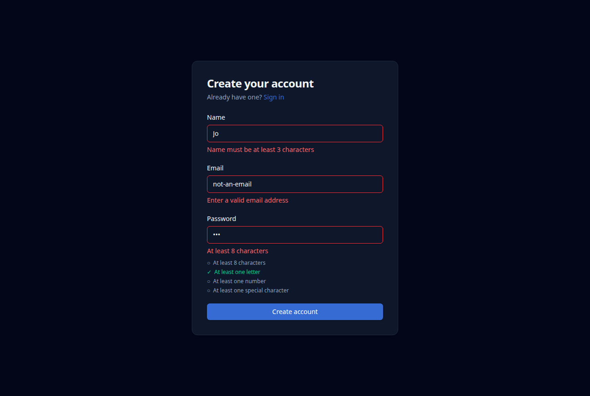
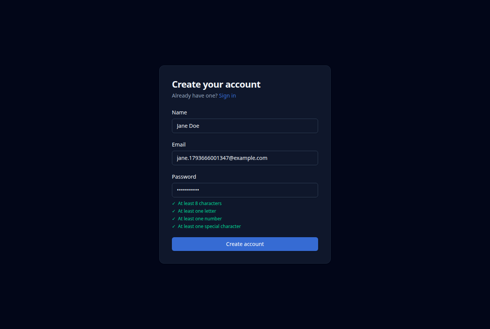
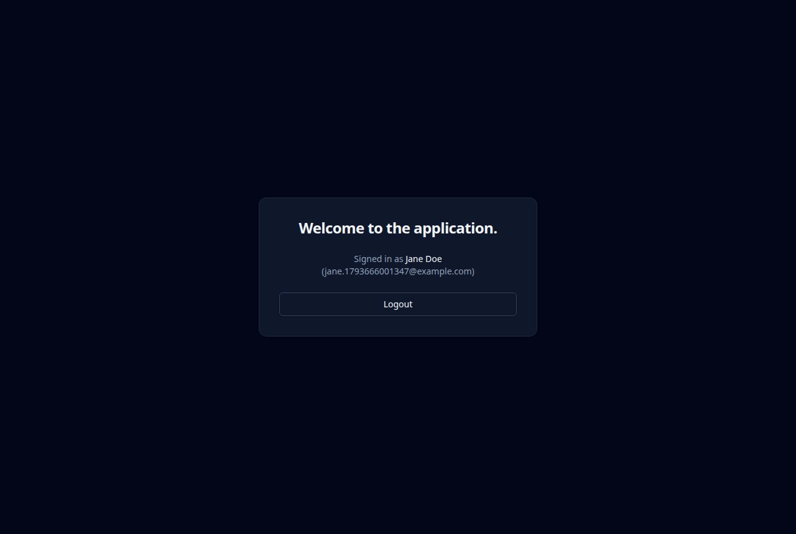
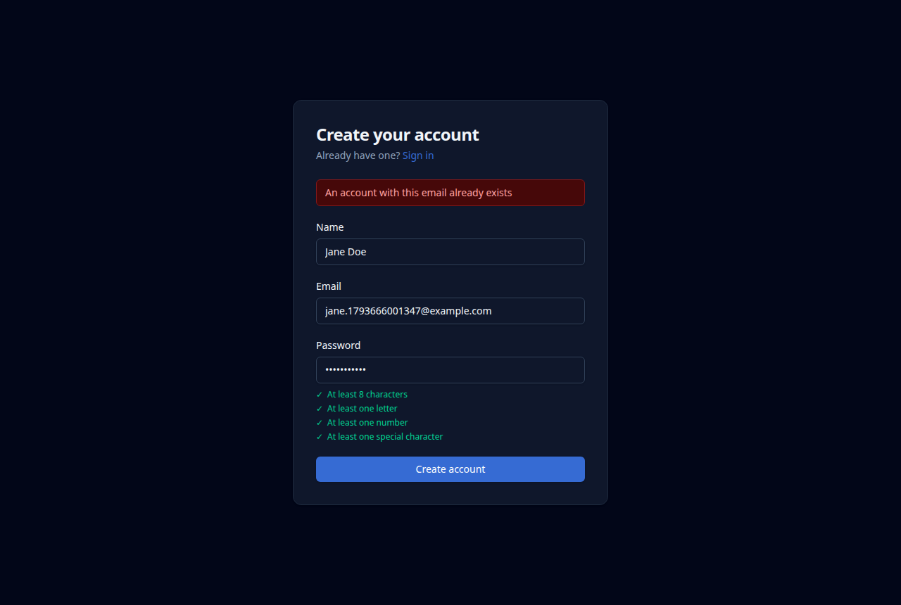
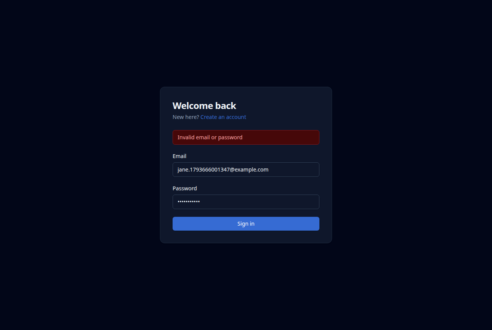
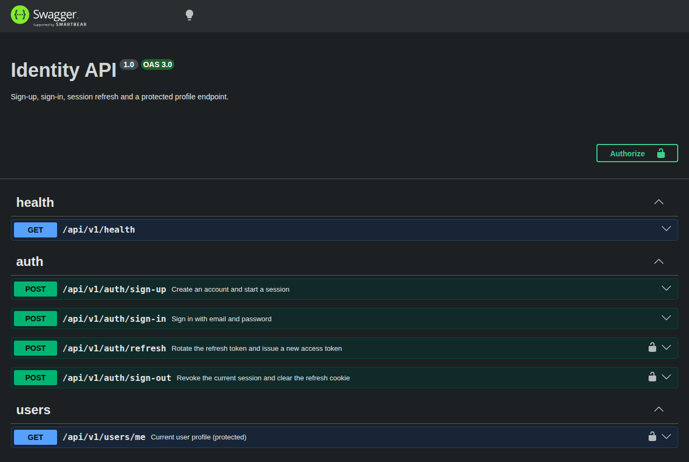
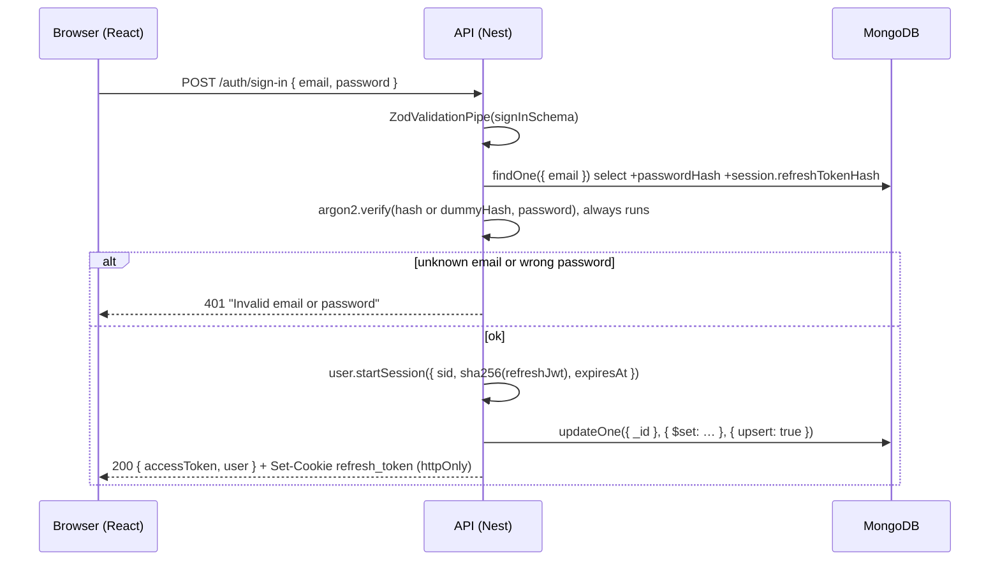
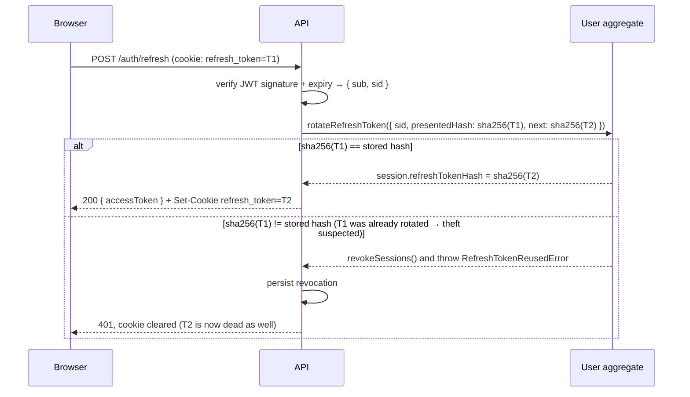

# Identity module — NestJS + MongoDB API, React web client

[](https://github.com/ayamahmoud-141020/identity-auth-module/actions/workflows/ci.yml)

A production-grade authentication module: sign-up, sign-in, silent session refresh with rotation and
reuse detection, sign-out, and a protected profile endpoint. One bounded context (`identity`), built
with a pragmatic DDD / vertical-slice / CQRS structure, and a single shared validation contract used
by the web forms, the API, and the domain.

| Workspace         | Stack                                                                         |
| ----------------- | ----------------------------------------------------------------------------- |
| `apps/api`        | NestJS 11, Mongoose 8, `@nestjs/cqrs`, argon2id, JWT, nestjs-pino, Swagger    |
| `apps/web`        | React 19, Vite, TypeScript, react-hook-form, Tailwind CSS                     |
| `packages/shared` | Zod schemas, field-rule constants, API contract types (consumed by both apps) |

---

## Contents

1. [Screenshots](#screenshots)
2. [Quick start](#quick-start)
3. [Configuration](#configuration)
4. [Scripts](#scripts)
5. [API reference](#api-reference)
6. [Authentication flow in depth](#authentication-flow-in-depth)
7. [Security model](#security-model)
8. [Architecture](#architecture)
9. [Validation: one source of truth](#validation-one-source-of-truth)
10. [Error handling and logging](#error-handling-and-logging)
11. [Testing strategy](#testing-strategy)
12. [Docker and CI](#docker-and-ci)
13. [Trade-offs and what was deliberately left out](#trade-offs-and-what-was-deliberately-left-out)
14. [Troubleshooting](#troubleshooting)

---

## Screenshots

Captured from the running app (`npm run dev:api` + `npm run dev:web`, system dark theme).

### Sign-up with live validation

Inline per-field errors (`aria-invalid`, `role="alert"`) and a password checklist that is derived
from the same rule constants the backend validates against.



All four password rules satisfied, submit enabled:



### Protected application page

After sign-up or sign-in the user lands on the protected route. The access token lives only in
memory; a full page reload restores the session silently through the httpOnly refresh cookie.



### Server-side errors surfaced in the UI

Duplicate email (`409 Conflict`, detected by the unique index, never by a pre-check):



Wrong password or unknown email both produce the same `401` and the same message (no user
enumeration):



### Swagger UI (`/api/docs`)



---

## Quick start

### Prerequisites

- Node.js ≥ 22 and npm ≥ 10
- MongoDB ≥ 7 running locally (or use Docker below)
- Docker + Compose v2 for the one-command stack

### Local development

```bash
npm ci                                   # installs all workspaces; postinstall builds packages/shared
cp apps/api/.env.example apps/api/.env   # set MONGODB_URI and both JWT secrets (≥ 32 chars, different)
npm run dev:api                          # http://localhost:3000/api/v1   Swagger: http://localhost:3000/api/docs
npm run dev:web                          # http://localhost:5173          (Vite proxies /api → :3000)
```

The web dev server proxies `/api` to the API, so the browser talks to a single origin and the
refresh cookie is first-party.

### Docker (one command)

```bash
docker compose up --build
```

| URL                                 | What                                                               |
| ----------------------------------- | ------------------------------------------------------------------ |
| http://localhost:8080               | Web app served by nginx, which proxies `/api` to the API container |
| http://localhost:3000/api/v1/health | API health (also exposed directly)                                 |

Port 8080 busy? `WEB_PORT=8081 docker compose up --build`.

Compose ships demo JWT secrets so it starts with zero setup. For anything beyond a local demo, put
`JWT_ACCESS_SECRET` and `JWT_REFRESH_SECRET` in a `.env` file next to `docker-compose.yml`. The API
container runs with `NODE_ENV=production`, so Swagger is disabled there and the cookie `Secure`
flag is relaxed only through the explicit `COOKIE_SECURE=false` override (plain http on localhost).

---

## Configuration

All API settings come from environment variables, validated at boot with a Zod schema
(`apps/api/src/shared/config/env.schema.ts`). If anything is missing or invalid the process exits
immediately with a readable list:

```
Invalid environment configuration:
  - MONGODB_URI: MONGODB_URI is required
  - JWT_ACCESS_SECRET: JWT_ACCESS_SECRET must be at least 32 characters
  - JWT_REFRESH_SECRET: JWT_ACCESS_SECRET and JWT_REFRESH_SECRET must differ
```

| Variable                                   | Default                 | Notes                                                                                |
| ------------------------------------------ | ----------------------- | ------------------------------------------------------------------------------------ |
| `NODE_ENV`                                 | `development`           | `development` enables pretty logs, Swagger, and 500 error messages in responses      |
| `PORT`                                     | `3000`                  |                                                                                      |
| `MONGODB_URI`                              | —                       | required                                                                             |
| `JWT_ACCESS_SECRET` / `JWT_REFRESH_SECRET` | —                       | required, ≥ 32 characters, must differ from each other                               |
| `ACCESS_TOKEN_TTL_SECONDS`                 | `900`                   | 15 minutes                                                                           |
| `REFRESH_TOKEN_TTL_SECONDS`                | `604800`                | 7 days                                                                               |
| `WEB_ORIGIN`                               | `http://localhost:5173` | CORS allow-list (credentials enabled)                                                |
| `TRUST_PROXY`                              | `false`                 | `true` behind nginx/ingress so throttling and `Secure` detection see the real client |
| `COOKIE_SECURE`                            | `true` in production    | Only set `false` for a plain-http demo behind a proxy                                |
| `THROTTLE_TTL_SECONDS` / `THROTTLE_LIMIT`  | `60` / `100`            | Global per-IP limit. Auth routes use stricter fixed limits (see Security model)      |
| `LOG_LEVEL`                                | `info`                  | pino level (`fatal` … `trace`, `silent`)                                             |

See `apps/api/.env.example` for a ready-to-copy file.

---

## Scripts

Run from the repository root.

| Command                                   | What it does                                                       |
| ----------------------------------------- | ------------------------------------------------------------------ |
| `npm run dev:api` / `npm run dev:web`     | API with `node --watch` + ts-node; web with Vite HMR               |
| `npm run build`                           | `packages/shared` → `apps/api` (`tsc`) → `apps/web` (`vite build`) |
| `npm run lint`                            | ESLint, type-aware, zero warnings allowed                          |
| `npm run format` / `npm run format:check` | Prettier                                                           |
| `npm run typecheck`                       | `tsc --noEmit` in every workspace                                  |
| `npm test`                                | shared (Vitest) → API unit + e2e (Jest) → web (Vitest)             |
| `npm run test:unit -w @app/api`           | API unit tests only (domain, handlers with fakes)                  |
| `npm run test:e2e -w @app/api`            | API e2e only (Supertest + in-memory MongoDB)                       |

The e2e suite uses `mongodb-memory-server`, which downloads a MongoDB binary on first run. To reuse an
installed server instead: `MONGOMS_SYSTEM_BINARY=/usr/bin/mongod npm test`.

---

## API reference

Base path `/api/v1`. Interactive documentation with schemas, examples and "Authorize" support is at
`/api/docs` (non-production). The raw OpenAPI document is at `/api/docs-json`.

| Method & path                                    | Auth                                  | Success                                            | Errors                                                  |
| ------------------------------------------------ | ------------------------------------- | -------------------------------------------------- | ------------------------------------------------------- |
| `POST /auth/sign-up` `{ email, name, password }` | —                                     | `201` `{ accessToken, user }` + refresh cookie     | `400` validation · `409` email taken · `429` rate limit |
| `POST /auth/sign-in` `{ email, password }`       | —                                     | `200` `{ accessToken, user }` + refresh cookie     | `400` · `401` "Invalid email or password" · `429`       |
| `POST /auth/refresh`                             | refresh cookie                        | `200` `{ accessToken, user }` + **rotated** cookie | `401` (cookie cleared)                                  |
| `POST /auth/sign-out`                            | refresh cookie                        | `204`, cookie cleared                              | never fails (idempotent)                                |
| `GET /users/me`                                  | `Authorization: Bearer <accessToken>` | `200` `{ id, email, name, createdAt }`             | `401` missing / malformed / expired / wrong signature   |
| `GET /health`                                    | —                                     | `200` `{ status: "ok", mongo: "up" }`              | `503` when MongoDB is unreachable                       |

### Field rules

Enforced identically in the web form, the API request pipe, and the domain value objects, all from
`packages/shared/src/field-rules.ts`:

| Field      | Rule                                                                                             |
| ---------- | ------------------------------------------------------------------------------------------------ |
| `email`    | Valid email; trimmed and lower-cased before validation and storage; ≤ 254 chars                  |
| `name`     | 3–100 characters after trimming                                                                  |
| `password` | 8–128 characters, at least one letter, one number, one special character (whitespace is not one) |

### Real responses

Sign-up (`201`). Note the cookie attributes and the request id header:

```http
HTTP/1.1 201 Created
x-request-id: 940a775e-6da0-495e-a91e-2885574570f3
Set-Cookie: refresh_token=<jwt>; Path=/api/v1/auth; Expires=Tue, 10 Nov 2026 00:34:09 GMT; HttpOnly; SameSite=Strict

{"accessToken":"eyJhbGciOiJIUzI1NiIsInR5cCI6IkpXVCJ9.<…>","user":{"id":"7b0fe797-1dca-4f01-aa94-11ae20422029","email":"readme.22193@example.com","name":"Jane Doe","createdAt":"2026-11-03T00:34:09.997Z"}}
```

Validation failure (`400`). Every failing rule is reported, per field:

```json
{
  "statusCode": 400,
  "error": "Bad Request",
  "message": "Request validation failed",
  "path": "/api/v1/auth/sign-up",
  "timestamp": "2026-11-03T00:34:10.012Z",
  "requestId": "859fed5d-5fb5-4e97-9765-f8304c7efd4c",
  "details": {
    "email": ["Enter a valid email address"],
    "name": ["Name must be at least 3 characters"],
    "password": ["At least 8 characters", "At least one number", "At least one special character"]
  }
}
```

Duplicate email (`409`), wrong credentials (`401`), and refresh-token reuse (`401`):

```json
{"statusCode":409,"error":"Conflict","message":"An account with this email already exists","path":"/api/v1/auth/sign-up","timestamp":"…","requestId":"…"}
{"statusCode":401,"error":"Unauthorized","message":"Invalid email or password","path":"/api/v1/auth/sign-in","timestamp":"…","requestId":"…"}
{"statusCode":401,"error":"Unauthorized","message":"Refresh token has already been used; session revoked","path":"/api/v1/auth/refresh","timestamp":"…","requestId":"…"}
```

### curl walkthrough

```bash
API=http://localhost:3000/api/v1

# 1. sign up (stores the refresh cookie in cookies.txt)
curl -s -c cookies.txt -H 'Content-Type: application/json' \
  -d '{"email":"jane@example.com","name":"Jane Doe","password":"Str0ng!pass"}' $API/auth/sign-up

# 2. call the protected endpoint
TOKEN=<accessToken from step 1>
curl -s -H "Authorization: Bearer $TOKEN" $API/users/me

# 3. rotate the session (new access token, new cookie)
curl -s -b cookies.txt -c cookies.txt -X POST $API/auth/refresh

# 4. sign out (204) — the cookie is cleared and the session revoked
curl -s -b cookies.txt -X POST $API/auth/sign-out -o /dev/null -w '%{http_code}\n'
```

---

## Authentication flow in depth

### Tokens

| Token         | Format                                     | Lifetime | Where it lives                                                            | Stored server-side as |
| ------------- | ------------------------------------------ | -------- | ------------------------------------------------------------------------- | --------------------- |
| Access token  | JWT `{ sub, email }`, HS256                | 15 min   | Response body → **JavaScript memory only** (never localStorage / cookies) | nothing (stateless)   |
| Refresh token | JWT `{ sub, sid, jti }`, HS256, own secret | 7 days   | `httpOnly; SameSite=Strict; Secure(prod); Path=/api/v1/auth` cookie       | SHA-256 hash          |

`sid` identifies the session, `jti` guarantees every rotation produces a new token (and hash) even
within the same second. The two JWT secrets must differ, so an access token can never be replayed as
a refresh token.

### Sign-in / sign-up



### Refresh with rotation and reuse detection



Reuse of an old refresh token is treated as compromise: the whole session is revoked, so the
attacker's token and the legitimate user's newest token both stop working, and the user has to sign
in again. This is covered by `user.aggregate.spec.ts`, `refresh-session.handler.spec.ts`, and the
e2e test "reuse of a rotated token → 401, session revoked, and the newest token is dead too".

### On the client

- `AuthProvider` starts in `loading`, calls `POST /auth/refresh` once (silent refresh), then becomes
  `authenticated` or `anonymous`. `ProtectedRoute` and `GuestRoute` render a loading state until then,
  so a reload never flashes the sign-in page for a logged-in user.
- The axios instance adds the bearer header from an in-memory store. On a `401` from any
  non-`/auth/*` request it performs **one** refresh for all concurrent callers (single in-flight
  promise), retries the queued requests once, and signs the user out if the refresh fails.
- Sign-out calls the API (revoking the session and clearing the cookie) and drops the in-memory token.

---

## Security model

| Concern             | Decision                                                                                                                                                              |
| ------------------- | --------------------------------------------------------------------------------------------------------------------------------------------------------------------- |
| Password storage    | argon2id, 19 MiB memory, 2 iterations, 1 lane (OWASP minimum). Hash is `select: false` in Mongoose and never serialized; responses come from explicit mappers         |
| User enumeration    | Same `401` message for unknown email and wrong password. Verification always runs (against a precomputed dummy hash when the user is unknown) so timing is comparable |
| Duplicate accounts  | Unique index on `email`; Mongo error `11000` is translated to `409` in the repository. No pre-check, so two concurrent sign-ups cannot both succeed (e2e-tested)      |
| Access token theft  | Memory-only storage limits exposure to the current tab; 15 min lifetime bounds the damage                                                                             |
| Refresh token theft | `httpOnly` (unreadable by scripts), `SameSite=Strict` (not sent cross-site), path-scoped to `/api/v1/auth`, rotated on every use, reuse revokes the session           |
| Brute force         | Per-IP throttling: global `100/min` (env), `10/min` on sign-up and sign-in, `30/min` on refresh. `429` with the standard error shape                                  |
| Transport hardening | `helmet` (CSP, HSTS, `nosniff`, `X-Frame-Options`, `Referrer-Policy: no-referrer`), CORS limited to `WEB_ORIGIN` with credentials, `GET/POST/OPTIONS` only            |
| Secrets in logs     | `authorization`, `cookie`, `set-cookie`, and any `password` field are redacted by pino; the `UserRegistered` log line carries the user id, not the email              |
| Configuration       | Validated at boot; weak (< 32 chars) or identical JWT secrets refuse to start                                                                                         |
| Error responses     | No stack traces outside `development`; 500s log the full error server-side with the request id                                                                        |
| Supply chain        | Small, budgeted dependency list; `npm ci` with lockfile in CI and Docker                                                                                              |

Headers observed on a real response:

```
Content-Security-Policy: default-src 'self';base-uri 'self';font-src 'self' https: data:;form-action 'self';frame-ancestors 'self';img-src 'self' data:;object-src 'none';script-src 'self';script-src-attr 'none';style-src 'self' https: 'unsafe-inline';upgrade-insecure-requests
Referrer-Policy: no-referrer
Strict-Transport-Security: max-age=31536000; includeSubDomains
X-Content-Type-Options: nosniff
X-Frame-Options: SAMEORIGIN
x-request-id: c8d88c70-f626-4863-ac61-86806f926d22
```

---

## Architecture

### Layout

```
apps/api/src
├── main.ts · app.module.ts · app.setup.ts     bootstrap; app.setup is shared with the e2e harness
├── shared/                                    cross-cutting kernel
│   ├── config/   env.schema.ts                 Zod env schema, fail-fast validation
│   ├── logging/  logger.module.ts              nestjs-pino: request id, redaction, pretty in dev
│   ├── http/     http-exception.filter.ts      the ONLY place errors become HTTP
│   │            zod-validation.pipe.ts         request bodies validated with the shared schemas
│   │            rate-limits.ts · api-error.dto.ts
│   └── health/   health.controller.ts
└── modules/identity/
    ├── identity.module.ts                      binds ports → adapters via injection tokens
    ├── domain/                                 ZERO framework imports (enforced by ESLint)
    │   ├── user.aggregate.ts                   register(), startSession(), rotateRefreshToken(), revokeSessions()
    │   ├── value-objects/                      Email, UserName, PlainPassword, PasswordHash
    │   ├── errors/                             DomainError subclasses (plain classes, no HTTP)
    │   ├── events/user-registered.event.ts
    │   └── ports/                              UserRepository, PasswordHasher, TokenIssuer (+ tokens)
    ├── features/                               VERTICAL SLICES, one folder per use case
    │   ├── sign-up/          command · handler · controller · request DTO · handler.spec
    │   ├── sign-in/          "
    │   ├── refresh-session/  "
    │   ├── sign-out/         "
    │   ├── get-current-user/ QUERY: lean projection, protected by JwtAuthGuard
    │   ├── user-registered/  the single event consumer (logs)
    │   └── common/           AuthSessionResult, startNewSession(), RefreshCookieService, Swagger DTOs
    └── infrastructure/
        ├── persistence/      user.schema.ts · user.mapper.ts · mongo-user.repository.ts
        └── security/         argon2-password-hasher.ts · jwt-token-issuer.ts · jwt-auth.guard.ts
```

### Request path for a command

```
HTTP → ThrottlerGuard → Controller (ZodValidationPipe) → CommandBus → Handler
     → value objects (re-validate) → aggregate (business rules) → ports → adapters → MongoDB
     ← AuthSessionResult ← Controller sets cookie, maps to AuthResponse
     ↳ any thrown DomainError / RequestValidationError / HttpException → HttpExceptionFilter → one JSON shape
```

### Why this shape

- **Vertical slices.** Adding or removing a use case touches one folder. Deleting
  `refresh-session/` removes the feature; nothing else references it except the module file.
- **Rich domain, thin handlers.** Rotation, reuse detection, revocation, and field invariants live in
  the aggregate and value objects and are tested with no mocks at all. Handlers orchestrate ports.
  Controllers only translate HTTP ⇄ command/query and never contain logic.
- **CQRS on a single database.** Commands change state through the aggregate; the one query reads a
  lean projection (`select email name createdAt`, `.lean()`) and never loads the aggregate. No event
  sourcing, no separate read store, no broker.
- **Ports and adapters.** `domain/ports` defines interfaces plus `Symbol` tokens; `identity.module.ts`
  binds them to Mongo/argon2/JWT adapters. Handler unit tests swap in in-memory fakes
  (`apps/api/test/fakes`), not Jest mocks of Mongoose.
- **Dependency rule, enforced.** `eslint.config.mjs` applies `no-restricted-imports` to
  `apps/api/src/modules/*/domain/**`, forbidding `@nestjs/*`, `mongoose`, `argon2`, `jsonwebtoken`,
  `express`, pino, and any import from `infrastructure/`, `features/` or app-level `shared/`.
  The domain may import only itself and `@app/shared`.
- **One domain event, one consumer.** `UserRegistered` is published after the save and handled by a
  logging handler. It exists to show the extension point (welcome email, analytics) without adding
  infrastructure.

### Data model

`users` collection (Mongoose schema in `infrastructure/persistence/user.schema.ts`):

| Field                      | Type          | Notes                                                           |
| -------------------------- | ------------- | --------------------------------------------------------------- |
| `_id`                      | string (UUID) | Application-generated; the domain does not depend on `ObjectId` |
| `email`                    | string        | **unique index**, normalized lower-case                         |
| `name`                     | string        |                                                                 |
| `passwordHash`             | string        | `select: false`                                                 |
| `session.id`               | string        | current session id (`sid` claim)                                |
| `session.refreshTokenHash` | string        | `select: false`, SHA-256 of the current refresh JWT             |
| `session.expiresAt`        | Date          |                                                                 |
| `createdAt`                | Date          | set by the aggregate on registration                            |

The repository builds the unique index explicitly in `onModuleInit` (`ensureIndexes`) rather than
relying on Mongoose's background `autoIndex`, so the duplicate-email guarantee holds from the first
request.

---

## Validation: one source of truth

```
packages/shared/src/field-rules.ts      constants + PASSWORD_RULES (id, label, test)
packages/shared/src/schemas/auth.schemas.ts   emailSchema, nameSchema, passwordSchema, signUpSchema, signInSchema
        │
        ├── apps/web  react-hook-form + zodResolver(signUpSchema)   → inline errors
        │             PasswordChecklist maps PASSWORD_RULES          → live checklist
        ├── apps/api  @Body(new ZodValidationPipe(signUpSchema))     → 400 with details
        │             Swagger DTO classes reference the constants   → docs cannot drift
        └── domain    Email.create / UserName.create / PlainPassword.create
                      re-run the same schemas → ValidationError (defence in depth)
```

A change to a rule is made once. The shared package has its own boundary tests (7 vs 8 characters,
each missing character class, whitespace not counting as special, email trimming and lower-casing,
unknown keys stripped).

For Node consumers the package is built to CommonJS (`packages/shared/dist`, built on `postinstall`).
The web app bundles it from the ESM source through a Vite alias so Zod can tree-shake (bundle went
from 853 kB to 443 kB, 142 kB gzipped).

---

## Error handling and logging

### One error shape

`HttpExceptionFilter` is a catch-all and the only place that knows HTTP status codes:

| Thrown                                                 | Status   | Notes                                                              |
| ------------------------------------------------------ | -------- | ------------------------------------------------------------------ |
| `RequestValidationError` (pipe)                        | 400      | `details: { field: [messages] }`                                   |
| `ValidationError` (domain)                             | 400      | same shape, from value objects                                     |
| `EmailAlreadyInUseError`                               | 409      |                                                                    |
| `InvalidCredentialsError`                              | 401      | generic message                                                    |
| `InvalidRefreshTokenError` / `RefreshTokenReusedError` | 401      | cookie cleared by the controller                                   |
| `UserNotFoundError`                                    | 404      | `/users/me` for a deleted account                                  |
| `HttpException` (guard, throttler, Nest)               | as given | e.g. `429 Too Many Requests`                                       |
| anything else                                          | 500      | logged with stack + request id; message hidden outside development |

### Logging

- `nestjs-pino` with one line per request (`request completed`), pretty-printed in development, JSON
  otherwise.
- A request id is generated per request (or taken from an incoming `x-request-id` header), returned
  in the `x-request-id` response header, and embedded in every error body, so a user-reported error
  can be matched to its log line.
- Redacted paths: `req.headers.authorization`, `req.headers.cookie`, `res.headers["set-cookie"]`,
  `req.body.password`, `*.password`.
- `/health` is excluded from request logging to keep probes quiet.

---

## Testing strategy

| Layer          | Runner                                   | Files                                                                         | What it proves                                                                                                                                                                                                            |
| -------------- | ---------------------------------------- | ----------------------------------------------------------------------------- | ------------------------------------------------------------------------------------------------------------------------------------------------------------------------------------------------------------------------- |
| Shared rules   | Vitest                                   | `packages/shared/src/schemas/auth.schemas.spec.ts`                            | boundary cases for every field rule, normalization                                                                                                                                                                        |
| Domain         | Jest (no mocks)                          | `domain/value-objects/value-objects.spec.ts`, `domain/user.aggregate.spec.ts` | invariants, secret non-serialization, rotation, reuse detection, expiry, revocation                                                                                                                                       |
| Handlers       | Jest + in-memory fakes                   | `features/*/*.handler.spec.ts`                                                | orchestration, identical error for unknown email vs wrong password, hasher always invoked, event publishing                                                                                                               |
| API end-to-end | Jest + Supertest + mongodb-memory-server | `apps/api/test/auth.e2e-spec.ts`                                              | every endpoint and status code, cookie attributes, **concurrent duplicate sign-up → one 201 + one 409**, token rejection (missing/garbage/expired/forged), rotation + reuse, sign-out, 429, helmet headers, Swagger paths |
| Web            | Vitest + Testing Library                 | `SignUpForm.test.tsx`, `ProtectedRoute.test.tsx`                              | per-field errors and `aria-invalid`, live checklist, normalized submit, disabled while pending, server banner, guard redirects and loading state                                                                          |

Totals: 16 shared + 58 API (32 unit, 26 e2e) + 8 web. Everything runs in CI on every push.

---

## Docker and CI

- **`apps/api/Dockerfile`**: multi-stage; builds shared + API with the lockfile, prunes dev
  dependencies, runs as a non-root user, ships a `HEALTHCHECK` against `/api/v1/health`.
- **`apps/web/Dockerfile`**: builds the static bundle, serves it with nginx; `nginx.conf` proxies
  `/api/` to the API container (forwarding `X-Forwarded-For` / `-Proto`) and falls back to
  `index.html` for client-side routes.
- **`docker-compose.yml`**: `mongo` (with healthcheck and a named volume) → `api` (waits for Mongo to
  be healthy) → `web`. The API has `TRUST_PROXY=true` because it sits behind nginx.
- **`.github/workflows/ci.yml`**: Node 22, `npm ci`, lint, format check, typecheck, build, tests for
  all workspaces; the MongoDB binary used by the e2e suite is cached between runs.

---

## Trade-offs and what was deliberately left out

**Kept proportionate on purpose**

- One bounded context; same database for commands and queries; no event sourcing or broker.
- One active session per user (sign-in replaces the previous session). Multi-device support would
  turn `session` into an array keyed by `sid`; the rotation logic would not change.
- Access tokens are stateless: sign-out kills the refresh token immediately, but an already-issued
  access token stays valid for up to 15 minutes. A denylist would need shared storage (Redis), which
  is out of scope.
- `CommandBus`/`QueryBus` for four commands and one query is a small indirection; it buys a uniform
  slice shape and a visible seam for cross-cutting behaviour (logging, metrics) later.

**Version pins, and why**

- NestJS 11 (CommonJS). NestJS 12 is ESM-only and would force Jest/ts-jest into ESM mode for no
  functional gain here.
- Mongoose 8. Mongoose 9's connection handshake fails inside Jest's VM sandbox; the app itself ran
  fine on 9 outside Jest.
- TypeScript 6.0. The current npm default (7.x) is not yet supported by typescript-eslint or ts-jest.

**Not implemented (next steps)**

Email verification, password reset, session/device management, per-account lockout or progressive
delay, roles and permissions, OAuth/social login, an outbox for domain events, Playwright browser
tests across web + API.

---

## Troubleshooting

| Symptom                                                  | Cause / fix                                                                                                                   |
| -------------------------------------------------------- | ----------------------------------------------------------------------------------------------------------------------------- |
| API exits with `Invalid environment configuration`       | Fill `apps/api/.env` from `.env.example`; secrets must be ≥ 32 chars and different                                            |
| `429 Too Many Requests` while developing                 | Auth routes allow 10 requests/min per IP; wait a minute or restart the API (in-memory counters)                               |
| Browser keeps the session after sign-out in another tab  | Expected until the access token expires (≤ 15 min); the refresh token is already revoked                                      |
| `docker compose up` fails binding port 8080              | `WEB_PORT=8081 docker compose up --build`                                                                                     |
| e2e tests are slow on first run                          | `mongodb-memory-server` downloads a MongoDB binary once; set `MONGOMS_SYSTEM_BINARY=/usr/bin/mongod` to reuse a local install |
| Types from `@app/shared` are missing after a fresh clone | `npm ci` runs the `postinstall` build; if you skipped scripts run `npm run build -w @app/shared`                              |
| Cookie not stored when calling the API cross-origin      | By design (`SameSite=Strict`, path-scoped). Serve the web app and `/api` from one origin (Vite proxy or nginx)                |

---

## Repository map

```
.
├── apps/api                 NestJS API                     ├── packages/shared        Zod rules, contracts
├── apps/web                 React client                   ├── docs/ai-session-notes.md  decision & correction log
├── docs/screenshots         images used above              ├── docs/screenshots
├── docker-compose.yml       mongo + api + web              ├── .github/workflows/ci.yml
├── AI.md                    how AI assistance was used     └── eslint.config.mjs      incl. the domain dependency rule
```
